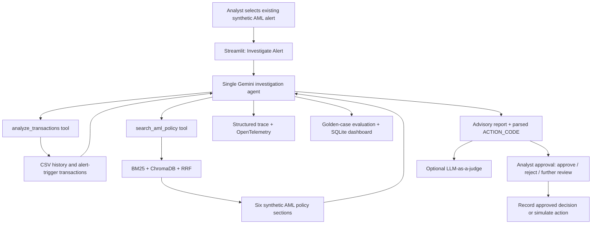

# AML Investigation Copilot — Agentic AI MVP

> **Synthetic banking demonstration | Not a production AML decision system.** This repository demonstrates an AI-assisted investigation workflow relevant to a large multinational bank. It is **not affiliated with any bank**, does not use real customer data or official regulatory policies, and does not perform live banking actions.

**Repository:** `ai-projects` — additional standalone experiments may coexist with this AML project.

## Contents

1. [Project overview](#project-overview)
2. [Quick start on Windows](#quick-start-on-windows)
3. [Prerequisites and dependencies](#prerequisites-and-dependencies)
4. [Gemini and Jaeger configuration](#gemini-and-jaeger-configuration)
5. [Architecture and end-to-end workflow](#architecture-and-end-to-end-workflow)
6. [Implemented MVP capabilities](#implemented-mvp-capabilities)
7. [Synthetic data and three demo scenarios](#synthetic-data-and-three-demo-scenarios)
8. [Six AML policies](#six-aml-policies)
9. [Governance, controls and human approval](#governance-controls-and-human-approval)
10. [Tracing and observability](#tracing-and-observability)
11. [Agent evaluation and LLM judge](#agent-evaluation-and-llm-judge)
12. [Hackathon demo runbook](#hackathon-demo-runbook)
13. [Troubleshooting and known limitations](#troubleshooting-and-known-limitations)
14. [Source code reference](#source-code-reference)

## Project overview

The **AML Investigation Copilot** helps an analyst investigate an already-generated suspicious-activity alert. It retrieves deterministic transaction evidence, searches a synthetic AML policy knowledge base, generates an evidence-grounded **advisory** assessment, and requests human approval before recording or simulating a case action. It includes execution tracing and evaluation tools to inspect what the AI did and how well it performed.

**Implemented architecture:** one Gemini LLM agent, with dynamic selection of **two allowlisted tools**, controlled tool execution, hybrid policy retrieval, a Streamlit interface, human-in-the-loop (HITL) approvals, OpenTelemetry instrumentation and an evaluation dashboard. This is **not** an implemented LangGraph multi-agent system.

**Out of scope:** generating AML alerts from a live transaction stream; live sanctions screening; bank integrations; actual account freezing, case closure or escalation; real regulatory reporting; production identity and access management.

### Technology stack

| Layer | Implementation |
|---|---|
| Interface | Streamlit |
| LLM | Google Gemini, via `google-genai` |
| Tool orchestration | Custom manual multi-round Gemini function-calling loop |
| Analytics | Python + pandas |
| Policy retrieval | BM25 (`rank-bm25`) + ChromaDB semantic retrieval + Reciprocal Rank Fusion |
| Synthetic data | CSV files |
| Governance | Input validation, tool allowlist, recommendation parsing, HITL approval and basic trace redaction |
| Tracing | Structured in-app trace events + OpenTelemetry OTLP/HTTP spans |
| Trace visualization | Optional separately running Jaeger |
| Evaluations | Golden cases, precision/recall/F1, reciprocal rank/MRR, Gemini LLM-as-a-judge |
| Persistence | Local SQLite for evaluation history and judge results |

## Quick start on Windows

Run commands from the **repository root** (where `llm.py` and `requirements.txt` are located).

### 1. Clone and enter the project

```powershell
git clone https://github.com/25Shruti/ai-projects.git
cd ai-projects
```

If already cloned, open a PowerShell terminal in your local `ai-projects` folder; do not clone a second copy.

### 2. Create and activate a Python 3.12 virtual environment

```powershell
py -3.12 -m venv .venv
.\.venv\Scripts\Activate.ps1
python -m pip install -r requirements.txt
```

If PowerShell prevents activation, run commands using `.\.venv\Scripts\python.exe` directly instead.

### 3. Set up the Gemini key

Create `.env` **in the repository root**:

```dotenv
GEMINI_API_KEY=your_google_ai_studio_api_key
```

Never commit your actual API key. The repository's `.gitignore` excludes `.env`.

### 4. Run the Streamlit application

```powershell
python -m streamlit run fraud_investigation/app.py
```

Open the URL shown by Streamlit (typically `http://localhost:8501`). Select an alert and click **Investigate Alert**.

**Execution note:** These instructions reflect the checked-in source and pinned dependencies. A clean install and a live API call have **not** been rerun as part of writing this documentation. Model availability and API quota depend on your Google account.

## Prerequisites and dependencies

- **Python 3.12** (the development environment used for this MVP), with `pip`.
- **Git** to clone/pull the repository.
- **Internet access** to call Gemini and install dependencies.
- **Google AI Studio API key** with access to the configured model.
- **Jaeger** only if you want to view OpenTelemetry spans in a graphical trace viewer. It is not necessary for the basic investigation UI.
- **Docker Desktop** only if using the optional Jaeger Docker command below; a separately installed Jaeger works too.

Root [`requirements.txt`](requirements.txt) pins the actual package versions. Important entries include `streamlit==1.67.0`, `google-genai==3.3.0`, `chromadb==1.5.9`, `rank-bm25==0.2.2`, `pandas==3.1.1`, `python-dotenv==1.2.4`, `opentelemetry-sdk==1.45.2`, and `opentelemetry-exporter-otlp-proto-http==1.45.2`.

The root [`llm.py`](llm.py) calls `load_dotenv()`, reads `GEMINI_API_KEY`, initializes `genai.Client`, and defines `DEFAULT_MODEL = "gemini-3.5-flash-lite"`. The model name is configurable **in code**; there is no separate environment variable for model selection.

## Gemini and Jaeger configuration

### Gemini API

The agent uses the configured Gemini model through Google's API. If you receive a model-not-found or quota error, verify the key, model availability, usage limits and network connection. The application does **not** host a local LLM.

### Optional Jaeger trace viewer

The checked-in repository **does not contain a Docker Compose file, Jaeger install script or proof of which local Jaeger distribution was previously installed**. The following is a suggested Docker-based setup, not a claim about the exact local command used during development:

```powershell
docker run --rm --name aml-jaeger -p 16686:16686 -p 4318:4318 jaegertracing/all-in-one:latest
```

- Jaeger UI: `http://localhost:16686`
- App's default OTLP/HTTP endpoint: `http://localhost:4318/v1/traces`
- Optional environment override: `OTEL_EXPORTER_OTLP_TRACES_ENDPOINT`

For example, to override the endpoint in the same PowerShell session before starting Streamlit:

```powershell
$env:OTEL_EXPORTER_OTLP_TRACES_ENDPOINT="http://localhost:4318/v1/traces"
python -m streamlit run fraud_investigation/app.py
```

A pinned, verified Jaeger image is preferable to `latest` for repeatable production-like setup. The exporter can be configured without a running Jaeger service, but spans will not be viewable until a compatible receiver is running.

## Architecture and end-to-end workflow



**Detailed execution sequence**

1. **Select alert:** The UI reads `alerts.csv` and `customers.csv` and shows severity, customer profile, KYC rating and alert description.
2. **Trigger:** The analyst clicks **Investigate Alert**. This is manual; there is no streaming alert listener.
3. **Validate:** The orchestrator validates the customer and alert ID formats.
4. **LLM planning/tool choice:** Gemini receives two function declarations. SDK automatic tool execution is disabled; application code dispatches model-requested calls.
5. **Transaction analysis:** The `analyze_transactions` tool calculates historical benchmarks and alert-specific patterns.
6. **Policy retrieval:** Gemini generates a policy query. The policy tool performs a **dynamic investigation search** and a **fixed disposition search**, both using hybrid retrieval.
7. **Synthesis:** Gemini returns a concise advisory report and an `ACTION_CODE` recommendation.
8. **Human decision:** Analyst requests approval and chooses approve, reject or further review. Only an approved request can be recorded/executed in simulation.
9. **Observability and evaluation:** Structured trace events are shown in Streamlit, OpenTelemetry spans are exported when possible, golden-case metrics are saved in SQLite, and the optional LLM judge can evaluate the report.

The orchestration loop permits **up to six rounds** of tool calls. Tool requests in the same round are processed **sequentially**, not as parallel specialist agents.

## Implemented MVP capabilities

### 1. Streamlit investigation workspace

- Three selectable synthetic alerts.
- Customer type, occupation, KYC risk rating, severity and alert description.
- One-click investigation.
- Transaction metrics: historical monthly average credit/debit, alert credit/debit, ratios against historical medians, new counterparties, international transfer count, rapid movement records and triggering transaction table.
- Hybrid RAG diagnostics: query text, BM25 ranking, ChromaDB semantic ranking, RRF ranking, retrieved policy contents.
- Generated investigation assessment and recommended action.
- HITL request/decision controls and approval audit record.
- Execution trace expander.
- Agent evaluation dashboard and optional LLM judge.
- Error diagnostics for investigation failures.

Source: [`fraud_investigation/app.py`](fraud_investigation/app.py).

### 2. Controlled, dynamic Gemini tool calling

**Only two tools are declared to the agent:**

| Tool | Parameters | Purpose |
|---|---|---|
| `analyze_transactions` | `customer_id`, `alert_id` | Deterministic analysis of the selected alert and customer history |
| `search_aml_policy` | `query`, optional `top_k` | Hybrid search for relevant AML policy sections |

The model selects tools; the application validates and executes them, then sends structured function responses back to the same Gemini chat. Unknown tool names are rejected. Transaction tool arguments must match the active investigation. An investigation that ends without transaction evidence is treated as an error.

**Not implemented:** independent LLM specialist agents, LangGraph routing, parallel agent execution or automatic execution of arbitrary model-generated Python.

### 3. Transaction behaviour analysis

[`transaction_analysis.py`](fraud_investigation/tools/transaction_analysis.py) implements:

- Historical transaction filter: dates before **1 November 2026**; synthetic history spans May–October 2026.
- Monthly total credit and debit; historical **mean** and **median**.
- Alert-triggering transaction credit and debit totals.
- Credit/debit ratios against historical monthly averages and medians.
- **New counterparties:** compare triggered counterparties against those seen historically.
- **International outgoing transfers:** triggered debits with country other than `IN`.
- **Rapid movement:** for each triggered incoming credit, look for subsequent triggered debits within **24 hours**, and report elapsed hours and outgoing amount as a percentage of that incoming credit.
- Retrieve the transactions referenced by the alert's `trigger_transaction_ids`.

These are deterministic descriptive/rule-based features, **not a trained anomaly-detection model**. A rapid-movement calculation does not establish that the exact same funds were transferred.

### 4. Hybrid policy RAG

[`policy_retriever.py`](fraud_investigation/rag/policy_retriever.py) parses six Markdown policy sections, runs:

1. **BM25** lexical keyword ranking.
2. **ChromaDB** semantic vector ranking, using a persistent local collection.
3. **Reciprocal Rank Fusion**, with `k=60`, to combine both rankings.

The orchestrator's policy tool uses **two searches**: a Gemini-generated investigation query and a fixed query about escalation, closure, missing evidence and human approval. Results are deduplicated by policy ID. The UI displays both queries and their intermediate rankings, not just the final retrieved text.

Tool-level validation permits `top_k` from **1 to 6** and a nonempty query of at most **500 characters**.

**Not implemented:** an explicit cross-encoder reranker, a tuned HNSW benchmark, live regulatory retrieval or deterministic policy-citation verification.

### 5. Evidence-oriented AI reporting

The agent system instructions request:

- **Investigation Summary**
- **Risk Assessment** with an indicative High/Medium/Low concern level
- **Recommended Action**
- Exactly one machine-readable `ACTION_CODE` line.

Permitted action codes: `escalate_case`, `request_information`, `close_alert`.

The prompt tells the model to cite retrieved policy IDs, avoid inventing facts, distinguish unusual activity from proven wrongdoing, consider plausible legitimate explanations, avoid interpreting raw ratios as formal anomaly scores, and leave final decisions to a human.

These are **prompt-based safeguards**; the code does not guarantee every statement is supported. The optional LLM judge provides post-generation assessment.

## Synthetic data and three demo scenarios

All source data is synthetic. Documentation uses **Customer 1 / 2 / 3** rather than personal or company names. The underlying CSV files remain unchanged for reproducibility.

### Dataset structure

| File | Actual fields |
|---|---|
| [`alerts.csv`](fraud_investigation/data/alerts.csv) | `alert_id`, `customer_id`, `trigger_transaction_ids`, `alert_timestamp`, `alert_type`, `alert_severity`, `alert_description`, `status` |
| [`customers.csv`](fraud_investigation/data/customers.csv) | `customer_id`, `customer_name`, `customer_type`, `occupation`, `kyc_risk_rating`, `account_open_date` |
| [`transactions.csv`](fraud_investigation/data/transactions.csv) | `transaction_id`, `customer_id`, `timestamp`, `amount_inr`, `direction`, `counterparty_id`, `country`, `channel` |

All three alerts are initially marked **Open** in `alerts.csv`.

### Customer profiles and scenarios

| Demo | Customer profile | Alert | Trigger transaction IDs | Focus |
|---|---|---|---|---|
| **Customer 1 — C101** | Individual, salaried employee; **Low** KYC risk | **AML-001**, High severity, Rapid Movement of Funds | `T101`, `T102` | Large domestic incoming credit, then rapid international outgoing transfer; compare timing, history and counterparties |
| **Customer 2 — C102** | Import/export business; **Medium** KYC risk | **AML-002**, Medium severity, Unusual High Value Transaction | `T201` | High-value international business payment; consider whether it fits business activity and history |
| **Customer 3 — C103** | Individual, independent consultant; **Medium** KYC risk | **AML-003**, Medium severity, Unusual Transaction Pattern | `T301`, `T302`, `T303` | Large incoming credit from a new counterparty followed by multiple outgoing transfers |

The following **triggering transactions** are reflected in the checked-in generator's scenario definitions; the committed CSV remains the authoritative file for actual execution:

| Alert | Transaction | Direction | Amount (INR) | Counterparty | Country |
|---|---|---|---:|---|---|
| AML-001 | T101 | Credit | 950,000 | CP_NEW1 | IN |
| AML-001 | T102 | Debit | 800,000 | CP_FOREIGN1 | AE |
| AML-002 | T201 | Debit | 1,200,000 | CP_SUPPLIER | SG |
| AML-003 | T301 | Credit | 600,000 | CP_NEW2 | IN |
| AML-003 | T302 | Debit | 250,000 | CP_UNKNOWN1 | IN |
| AML-003 | T303 | Debit | 200,000 | CP_UNKNOWN2 | IN |

For **AML-001**, the scenario is a ₹950,000 credit followed 2.5 hours later by a ₹800,000 international debit: approximately **84.21%** of the incoming amount. This is a pattern indicator, not proof of money laundering or definitive tracing of the same funds.

**Important generator caveat:** The checked-in `transactions.csv` uses timestamps such as `21-05-2026 09:00` and the analytics loader expects `%d-%m-%Y %H:%M`. However, [`generate_transactions.py`](fraud_investigation/data/generate_transactions.py) currently writes timestamps in `%Y-%m-%d %H:%M:%S` format. **Do not regenerate/overwrite the committed transactions CSV immediately before a demo** without first reconciling the format and retesting the application.

## Six AML policies

All six are in [`fraud_investigation/rag/aml_policy.md`](fraud_investigation/rag/aml_policy.md), labelled **DEMO-1.0 — Synthetic training document**. These are **not official policies of any bank**.

| ID | Exact policy title | Key requirements |
|---|---|---|
| **POL-001** | Transaction Behaviour Review | Compare flagged amounts, frequency, counterparties and geography with customer history; unusual activity is not proof |
| **POL-002** | Rapid Movement of Funds | Review time between transfers, relative amounts, source of funds, beneficiary and economic rationale; temporal proximity does not prove identical funds |
| **POL-003** | International Transfers | Check beneficiary, stated purpose, geographic history, applicable sanctions results and supporting documentation; international payments are not automatically suspicious |
| **POL-004** | Customer Due Diligence | Consider KYC, occupation, business activity, risk rating and available documents; low KYC risk does not negate significant indicators |
| **POL-005** | Escalation and Case Closure | Escalate unexplained material risk; recommend closure only with sufficient explanation and required checks; final decision remains human |
| **POL-006** | Investigation Documentation | Record alert/customer IDs, transaction evidence, indicators, policy references, missing evidence, recommended action and human decision; maintain auditability |

The entire authoritative policy text is available through the linked Markdown file. **Policy text requesting sanctions checks is not equivalent to having implemented a sanctions-screening API.**

## Governance, controls and human approval

### Implemented controls

| Control | Actual behaviour |
|---|---|
| Tool allowlist | Orchestrator dispatches only `analyze_transactions` and `search_aml_policy` |
| Input format validation | Customer IDs must match `C` + 3–8 digits; alert IDs must match `AML-` + 3–8 digits |
| Tool argument binding | Transaction tool arguments must match the selected customer and alert |
| Policy search validation | Nonempty query, length ≤ 500, integer `top_k` 1–6 |
| Bounded execution | Maximum six model/tool rounds |
| Final recommendation parsing | Exactly one permitted `ACTION_CODE` is accepted; invalid/missing code disables approval in UI |
| HITL | Explicit request; analyst chooses **Approve**, **Reject** or **Request Further Review** |
| Approval audit record | Request ID, alert/customer IDs, action, status, created/decided timestamps, analyst ID |
| Execution gate | Approved status, analyst and decision timestamp required |
| Basic trace redaction | Recursively masks email and Indian mobile-number patterns in structured trace event details |
| Evidence-based prompting | Instructions prohibit fabricated evidence, automatic final decisions and treating suspicion as guilt |

### Exact action semantics

- **`escalate_case`** — approved request produces a **simulated success** record; no live case API is invoked.
- **`request_information`** — approved request produces **REVIEW_RECORDED**; no real customer message is sent.
- **`close_alert`** — approved request produces **REVIEW_RECORDED**; no CSV status change or live case closure occurs.
- **`freeze_account`** — appears in the approval module's internal allowed actions, but is **not a permitted agent recommendation** and is **not exposed in the current UI**; any module-level result is simulated.

**Crucial boundary:** Human approval gates **final action recording/simulation**, **not** the two read-only analysis/retrieval tools. The analyst identity is typed into a text field, not authenticated by enterprise SSO. Approval state is stored in the Streamlit session rather than an immutable enterprise audit database.

Sources: [`approval.py`](fraud_investigation/governance/approval.py), [`guardrails.py`](fraud_investigation/governance/guardrails.py).

## Tracing and observability

The application implements **two distinct trace mechanisms**.

### A. Structured application execution trace

Each investigation gets an application UUID `trace_id`. Timestamped events are recorded and displayed in the **Execution Trace** Streamlit expander. Events include:

- `investigation_started`
- `tool_requested` with tool name, arguments and round
- `guardrail_blocked` for certain invalid inputs
- `tool_completed` with duration, success and result-key summary
- `preparing_tool_response` and `sending_tool_responses`
- `gemini_response_received`
- `investigation_completed` with total duration and round count
- `investigation_failed` with diagnostic error information

The structured trace is not a complete stored transcript of every raw prompt, token or tool payload.

### B. OpenTelemetry distributed spans

[`telemetry.py`](fraud_investigation/observability/telemetry.py) sets service name `aml-investigation-copilot` and deployment environment `demo`, then configures an OTLP HTTP batch exporter.

Instrumented span names:

| Span | Purpose |
|---|---|
| `aml.investigation` | Root span for investigation |
| `gemini.initial_investigation` | Initial model call |
| `tool.analyze_transactions` | Transaction analysis execution |
| `tool.search_aml_policy` | Policy retrieval execution |
| `gemini.process_tool_results` | Subsequent Gemini call after tool responses |

**Jaeger walkthrough:** Start Jaeger with OTLP HTTP reception, run an investigation, open `http://localhost:16686`, select service `aml-investigation-copilot`, then search. The code's application UUID and OpenTelemetry's trace ID are **not explicitly linked**. Exporter configuration does not prove successful trace ingestion.

**Privacy limitation:** Basic email/phone masking does not remove all personal information, customer identifiers, transaction values or exception content. This is safe only with synthetic data.

## Agent evaluation and LLM judge

### A. Golden evaluation dataset

[`golden_dataset.py`](fraud_investigation/evals/golden_dataset.py) defines **three** evaluation cases:

| Alert | Expected tool names | Expected policy IDs |
|---|---|---|
| AML-001 | `analyze_transactions`, `search_aml_policy` | POL-002, POL-003 |
| AML-002 | same | POL-001, POL-004 |
| AML-003 | same | POL-001, POL-005 |

### B. Quantitative metrics

[`agent_evaluator.py`](fraud_investigation/evals/agent_evaluator.py) and [`record_evaluation.py`](fraud_investigation/evals/record_evaluation.py) compute:

- **Tool precision, recall and F1:** compare unique requested tool names with expected tools.
- **Policy precision, recall and F1:** compare retrieved policy IDs against golden expected IDs.
- **Reciprocal rank:** inverse of rank of first expected policy found; the dashboard reports the average as **MRR**.

**Limits:** Tool F1 uses sets, so it does **not** penalize duplicate tool calls or test full argument correctness and ordering. Policy ID overlap does **not** prove grounded report citations. Three golden cases are demonstration coverage, not a production benchmark.

### C. Evaluation persistence and dashboard

[`eval_store.py`](fraud_investigation/evals/eval_store.py) stores run records in local SQLite `fraud_investigation/evals/evaluations.db` (ignored by Git). Saved fields include run ID, timestamp, alert, status/error, trace ID, requested tools, retrieved policies and metrics.

[`dashboard.py`](fraud_investigation/evals/dashboard.py) displays investigation count, average tool F1, average policy recall, MRR, run history, a policy metric trend and selected-run details.

### D. LLM-as-a-judge

Click **Run LLM Judge** after an investigation. [`llm_judge.py`](fraud_investigation/evals/llm_judge.py) sends the report and its supporting transaction/policy evidence to a separate Gemini call, with structured Pydantic output:

- Extract material factual claims and mark each **supported / unsupported**, with explanation.
- Calculate **groundedness = supported claims ÷ assessed claims** (zero if no claims).
- Produce **decision quality score (0–1)**, recommended decision and explanation, considering missed risks, premature closure and unjustified escalation.
- Save and display the result, including claim-level assessments.

The judge uses the **same configured model family**, not a separate vendor. It is an **optional post-hoc quality assessment**, not a guaranteed objective truth test or an automatic decision gate.

### Running evaluation scripts

From the repository root, with the environment activated and API key configured:

```powershell
python -m fraud_investigation.test_orchestrator
python -m fraud_investigation.evals.agent_evaluator
```

The first is a single-alert smoke test; the second runs the three golden cases through the live agent. These invoke Gemini and may consume quota. These commands are based on source inspection, not a fresh execution during README preparation.

## Hackathon demo runbook

### Pre-demo checklist

- [ ] Open terminal at repository root; activate `.venv`.
- [ ] Confirm `GEMINI_API_KEY` is available in local `.env`; never show the key on screen.
- [ ] Verify Gemini model access and internet connectivity.
- [ ] Launch `python -m streamlit run fraud_investigation/app.py`.
- [ ] Confirm all three alert IDs appear.
- [ ] Optionally start Jaeger; confirm `http://localhost:16686` loads.
- [ ] Run a full investigation and inspect its trace, approval UI and evaluation dashboard before the live session.
- [ ] Keep the synthetic policy document and this README accessible.

### Suggested 8–10-minute live demo

| Step | Action | Talking point |
|---|---|---|
| 1 | Select **AML-001 / Customer 1** | The alert comes from an assumed upstream detection system; this MVP begins at investigation |
| 2 | Click **Investigate Alert** | Single Gemini agent chooses from two controlled tools |
| 3 | Show transaction behaviour | Historical averages/medians, large-value deviations, new counterparties, rapid movement and cross-border transfer |
| 4 | Expand policy retrieval | Show BM25 vs ChromaDB vs RRF, two query types and actual synthetic policy passages |
| 5 | Read the AI assessment | Explain evidence-grounded advisory narrative and `ACTION_CODE` |
| 6 | Request approval; approve/reject/further review | Demonstrate explicit human gate and **simulated** action |
| 7 | Expand Execution Trace; optionally Jaeger | Show structured event trail and OpenTelemetry spans |
| 8 | Open evaluation dashboard; run LLM judge | Show tool/retrieval metrics and claim-level groundedness / decision quality |

If time permits, select **AML-002** (business international payment) or **AML-003** (ambiguous multi-transfer pattern) to demonstrate that scenarios differ. **Do not promise a specific Gemini recommendation or numerical evaluation score** without running that case.

### 30-second presentation summary

> “This is an AI-assisted AML Investigation Copilot built for a synthetic enterprise banking scenario. A single Gemini agent dynamically calls controlled transaction-analysis and hybrid policy-retrieval tools. The analytics are deterministic, while policy retrieval combines BM25, ChromaDB and reciprocal-rank fusion. The agent generates an evidence-oriented advisory assessment and proposed action, which requires human approval before any simulated case action. We also implemented structured traces, OpenTelemetry instrumentation, golden-case tool and retrieval evaluations, persistent evaluation history, and an optional LLM judge for groundedness and decision quality.”

## Troubleshooting and known limitations

| Symptom | Check |
|---|---|
| Missing `GEMINI_API_KEY` | Create `.env` at repository root and run from there |
| Gemini API/model failure | Model name in `llm.py`, key permissions, quota and internet |
| Python import error | Activate correct venv; run Streamlit from repository root |
| ChromaDB error | Installed package versions and writable local `rag/chroma_db` |
| Jaeger shows no service | Receiver running on port 4318, exporter endpoint, traces emitted and batch export completed |
| No evaluation records | Run an investigation; check local SQLite file and write permissions |
| No actionable recommendation | Verify model output has exactly one valid `ACTION_CODE` line |
| Inconsistent alert context | See Streamlit state caveat below; refresh and rerun the selected case |

**Known boundaries / issues requiring further validation**

1. **No real bank integration:** synthetic CSVs and synthetic policies only; no core banking, sanctions, KYC API, external case system, SAR submission or live financial action.
2. **Single agent, not multi-agent:** no LangGraph, specialist-agent delegation or parallel multi-agent execution.
3. **No upstream trained detection model:** pre-generated alerts; rule-based investigation indicators only.
4. **No enterprise identity controls:** analyst ID is typed; no SSO/RBAC, maker-checker verification or durable immutable approval ledger.
5. **Limited redaction:** email/Indian phone patterns in structured event details, not comprehensive PII controls.
6. **No deterministic citation verifier:** prompt instructs policy grounding; judge evaluates after the fact.
7. **Small evaluation set:** only three golden scenarios; no production false-positive/false-negative assessment.
8. **Potential Streamlit state mismatch:** results are partly scoped by `investigated_alert_id`, while recommendation/judge use `latest_investigation`; switching alerts after a run can require a fresh investigation to avoid mixed context.
9. **Generator timestamp mismatch:** regenerating transactions without adjusting the timestamp format may break the analytics loader.
10. **Local-only observability:** OpenTelemetry export configured; Jaeger ingestion must be verified separately.
11. **No production-scale infrastructure:** no autoscaling, queues, vLLM, quantization, GPU serving, distributed feature store or tuned HNSW.
12. **No live execution test in this documentation pass:** README reflects reviewed code and checked-in synthetic data, not a verified deployment.

## Source code reference

| File | Role |
|---|---|
| [`llm.py`](llm.py) | Gemini client, environment loading, model selection |
| [`fraud_investigation/app.py`](fraud_investigation/app.py) | Streamlit UI, investigation trigger, HITL, traces, judge and dashboard |
| [`agents/orchestrator.py`](fraud_investigation/agents/orchestrator.py) | Gemini chat, dynamic tool loop, tool validation, recommendation extraction, tracing |
| [`agents/investigator.py`](fraud_investigation/agents/investigator.py) | Report system instructions and helper |
| [`tools/transaction_analysis.py`](fraud_investigation/tools/transaction_analysis.py) | Historical comparisons and alert-pattern analysis |
| [`rag/policy_retriever.py`](fraud_investigation/rag/policy_retriever.py) | BM25, ChromaDB, RRF and dual-query retrieval |
| [`rag/aml_policy.md`](fraud_investigation/rag/aml_policy.md) | Six synthetic policies |
| [`governance/guardrails.py`](fraud_investigation/governance/guardrails.py) | Validation and basic trace PII redaction |
| [`governance/approval.py`](fraud_investigation/governance/approval.py) | Human decision records and simulated action gate |
| [`observability/telemetry.py`](fraud_investigation/observability/telemetry.py) | OpenTelemetry OTLP/HTTP exporter |
| [`evals/golden_dataset.py`](fraud_investigation/evals/golden_dataset.py) | Three golden evaluation cases |
| [`evals/agent_evaluator.py`](fraud_investigation/evals/agent_evaluator.py) | Tool and policy metric functions; golden-case runner |
| [`evals/record_evaluation.py`](fraud_investigation/evals/record_evaluation.py) | Per-investigation metrics and recording |
| [`evals/eval_store.py`](fraud_investigation/evals/eval_store.py) | SQLite storage |
| [`evals/dashboard.py`](fraud_investigation/evals/dashboard.py) | Evaluation dashboard |
| [`evals/llm_judge.py`](fraud_investigation/evals/llm_judge.py) | Groundedness and decision-quality assessment |
| [`data/alerts.csv`](fraud_investigation/data/alerts.csv) | Three alert records |
| [`data/customers.csv`](fraud_investigation/data/customers.csv) | Three synthetic customer profiles |
| [`data/transactions.csv`](fraud_investigation/data/transactions.csv) | Historical and alert-trigger transactions |
| [`data/generate_transactions.py`](fraud_investigation/data/generate_transactions.py) | Historical synthetic data generator; see timestamp warning |
| [`test_orchestrator.py`](fraud_investigation/test_orchestrator.py) | Single-case smoke test |

---

**Accuracy note:** The above describes the repository's implemented MVP, based on source inspection. It intentionally separates existing code, externally required services, demo-only simulated behaviour, known issues and proposed production enhancements.
